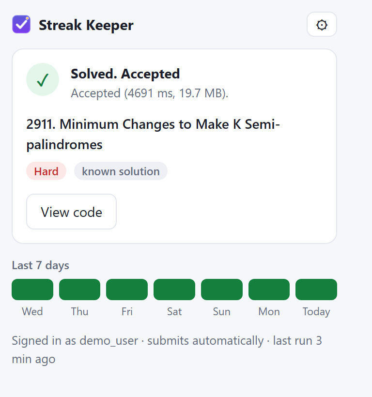

# Daily Streak Keeper for LeetCode

A Chrome / Edge extension that keeps your LeetCode daily streak. While your browser is open, it checks the problem of the day, finds a working solution, runs it on the example tests and submits it. It needs no server, no password and no paid API.

**Website & download:** https://researchinblockchain.github.io/daily-streak-keeper/



## Features

- **Hands-off.** It checks every 20 minutes, at browser start-up, when the laptop wakes or comes back online, and right after you log in. Once today's problem is solved, every later check stops immediately.
- **Known solutions first.** It looks up the open-source [doocs/leetcode](https://github.com/doocs/leetcode) collection (through the jsDelivr CDN).
- **Optional free AI backup.** For brand-new problems, Google Gemini, Groq or OpenRouter (with your own free key) writes a solution. Failed tests are fed back to the AI to fix.
- **Safe submits.** Every candidate must pass the example tests before it's submitted, with at most N submissions per day.
- **Two modes:** *Automatically*, or *Ask me first* (you read the code and click Submit).
- **Guided UI:** a popup with today's status and a 7-day strip, and a dashboard with a setup guide, how-it-works, history, settings and activity log.
- **Private.** Everything stays in `chrome.storage.local`, and there is no analytics.

## Install (developer mode)

1. Download **[daily-streak-keeper.zip](https://github.com/researchInBlockchain/daily-streak-keeper/releases/latest/download/daily-streak-keeper.zip)** and unzip it somewhere permanent. (Or clone this repo and use the `extension/` folder.)
2. Open `chrome://extensions` (or `edge://extensions`) and turn on **Developer mode**.
3. Click **Load unpacked** and select the unzipped folder (the one containing `manifest.json`).
4. The setup guide opens. Log in to leetcode.com in the same browser and click **Solve today's problem now**.

## How it works

```
alarm / startup / wake / online / login
        │
        ▼
 already solved today? ── yes ──► stop
        │ no
        ▼
 open a background leetcode.com tab (LeetCode only accepts requests from its own pages)
        │
        ├─ who am I? (logged in?)        ── no ──► "Log in" notification, retry after login
        ├─ today's daily problem (GraphQL)
        ├─ already solved by you?         ── yes ──► done
        ▼
 candidate = doocs/leetcode solution  ─┐
            or AI-written solution    ─┤──► run example tests ──► submit ──► Accepted ✓
            (AI gets failures to fix) ─┘
        │
        ▼
 close tab · save result · notification
```

| File | Role |
|---|---|
| `extension/src/background.js` | Service worker: decides *when* to run |
| `extension/src/agent.js` | Orchestration, storage, background-tab transport, notifications |
| `extension/src/solver.js` | Solving pipeline (no browser APIs, so it's testable in Node) |
| `extension/src/leetcode.js` | LeetCode API client (GraphQL, run, submit, judge polling) |
| `extension/src/ai.js` | Gemini / Groq / OpenRouter |
| `extension/src/lib.js` | Pure helpers |
| `extension/ui/` | Popup and dashboard |

## Development

```bash
npm test
```
```bash
npm run test:live
```
`npm test` runs the unit tests. `npm run test:live` checks the public endpoints: it fetches today's problem and a known solution, with no login.

Build the zip for the Chrome Web Store:

```bash
python scripts/package.py
```

Regenerate icons with `python scripts/make_icons.py` (needs Pillow).

## Publishing to the Chrome Web Store

1. Register a developer account at the Chrome Web Store Developer Dashboard (one-time US$5 fee).
2. Run `python scripts/package.py` and upload `dist/daily-streak-keeper-<version>.zip`.
3. Fill in the listing and privacy tabs with [`store/listing.md`](store/listing.md), and link [`store/privacy-policy.md`](store/privacy-policy.md) as the privacy policy.
4. Add screenshots (1280×800) of the popup and dashboard.

## Also in this repo

[`python-agent/`](python-agent/) is the earlier Windows version: a Python script started by Task Scheduler whenever the laptop connects to a network. It runs even when the browser is closed.

## Disclaimer

Not affiliated with or endorsed by LeetCode. Automated submissions may conflict with LeetCode's terms of service; use it on your own account at your own risk. Solutions from doocs/leetcode are written by its contributors (CC BY-SA 4.0). This tool keeps a streak; it doesn't teach you algorithms.

## License

MIT

## Releasing a new version

1. Bump `version` in `extension/manifest.json`.
2. Run `python scripts/package.py`.
3. Run `gh release create vX.Y.Z dist/daily-streak-keeper.zip dist/daily-streak-keeper-X.Y.Z.zip`. The website's Download button always points to the latest release's `daily-streak-keeper.zip`.

Website: `docs/`, served by GitHub Pages. Screenshots: serve the repo root (`python -m http.server`), open `scripts/screens/harness.html?page=dashboard` (or `page=popup`, `state=ready|pending`) and capture it.
